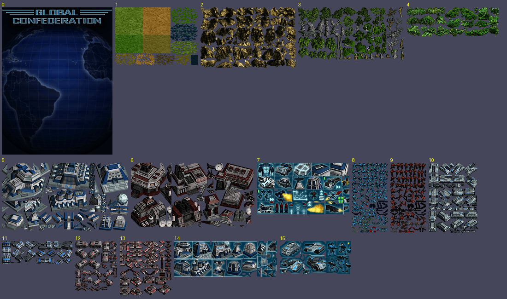
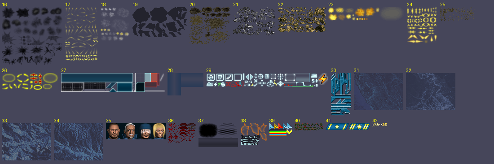

# What art is in the game?

> **In one line:** 43 sprite sheets packed into one file, `i0`; these two
> pictures show all of them.

## The short answer
- Sheets 0-15 are the big ones: title art, terrain, buildings, units, icons.
- Sheets 16-42 are effects, HUD, briefing pictures and small UI parts.
- 16 sheets come with a separate transparency mask for soft edges (smoke,
  glows, HUD).
- How the sheets are cut into frames and animated is covered in the
  [animations folder](../animations/README.md).

## How it works

| # | Content | # | Content |
|---|---|---|---|
| 0 | Title screen (240x320) | 8 | Confederation infantry (blue) |
| 1 | Ground tiles | 9 | Rebel infantry (red) |
| 2 | Rocks | 10, 11 | Confederation vehicles and parts |
| 3 | Trees | 12, 13 | Rebel vehicles and parts |
| 4 | Bushes | 14 | Building icons for the build menu |
| 5 | Confederation buildings | 15 | Unit icons for the build menu |
| 6 | Rebel buildings | | |
| 7 | Research and action icons | | |

| # | Content | # | Content |
|---|---|---|---|
| 16 | Smoke and scorch marks | 29 | HUD icons |
| 17 | Tracer lines | 30 | Circuit-pattern panel art |
| 18 | Dust and small puffs | 31-34 | Satellite photos for briefings |
| 19 | Dark shadow shapes | 35 | Four character portraits |
| 20-22 | Rubble and debris | 36 | Red chevrons |
| 23 | Explosion sequence | 37 | Shading patterns |
| 24 | Muzzle flashes and sparks | 38 | Map place-name labels |
| 25 | Small debris | 39 | Coloured flags and bars |
| 26 | Selection rings and markers | 40 | Small decorative strip |
| 27, 28 | HUD panels | 41 | Rank insignia strip |
| | | 42 | Tiny markers |

The labels are from looking at the pictures. The animation notes confirm
which sheet each kind of object really uses.

## How we know
- `../source/tools/sprites_extract.py` splits `i0` into 86 slots = 43 colour
  images, 16 with a mask; it consumes the file to the last byte (Observed)
- `../source/tools/sprites_contact_sheet.py` made the two pictures (Observed)
- [`k.java:991`](../source/decompiled/k.java#L991) : the loader these scripts copy (Observed)
- Sheet contents (Inferred from viewing)

## Still unknown
- Exact use of sheets 19, 30, 37, 40, 42.

**Next:** [The `sn8p` file format](../04-data-formats/01-sn8p-text-file.md)
