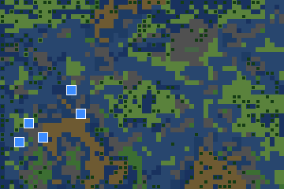
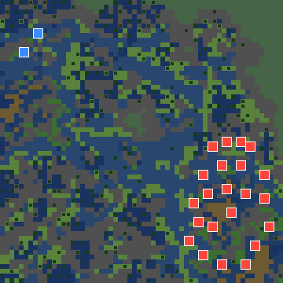
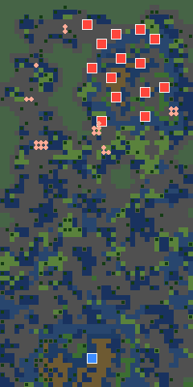
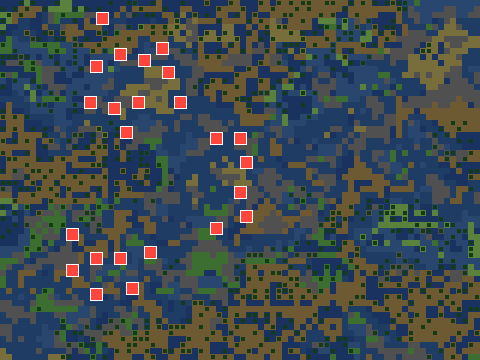
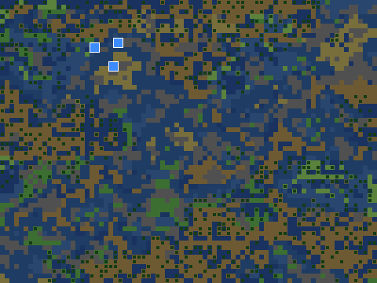
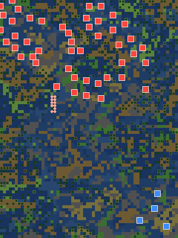
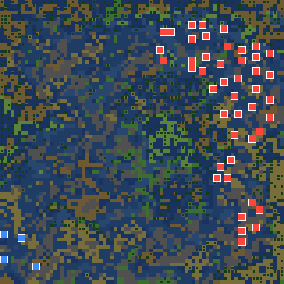

# What are the seven missions?

> **In one line:** A seven-mission campaign through Peru, from a defended
> jungle base to an assault on the rebels' main base in the mountains.

## The short answer
- Missions 1-3 use the jungle tileset, 4-7 the mountain tileset.
- Missions 4 and 5 are played on the same map: first you attack an outpost,
  then you defend the same ground.
- Missions 1 and 5 have no enemy buildings at all. Their objective texts
  are about holding a position, so the attackers must be brought in by the
  mission script (inferred).
- The pictures below are schematics drawn from the mission files: blue
  squares are your starting buildings, red squares are rebel buildings,
  small dots are placed objects. Ground colours are a rough bucketing of
  tile numbers, not the game's art.

## How it works

| # | Name | Map | Size | You start with | Rebel buildings | Objective text |
|---|---|---|---|---|---|---|
| 1 | Pucallpa | `m0` | 60x40 | Command center, Generator, Infantry center, 2 Bunkers | 0 | Build the base, repel the attack (`T2_13`, `T2_17`) |
| 2 | Ucayali Bank | `m1` | 60x60 | Command center, Generator | 22 | Build a base; destroy enemy base (`T2_43`) |
| 3 | Miguel Capture | `m2` | 40x80 | Command center | 14 | Destroy the rebels' headquarters (`T2_59`) |
| 4 | Outpost | `m3` | 80x60 | nothing | 24 | Destroy the rebels' outpost (`T2_66`) |
| 5 | Slaughter | `m3` | 80x60 | Command center, 2 Generators | 0 | Hold on till reinforcements arrive (`T2_71`) |
| 6 | Storm In Gorge | `m4` | 60x80 | Command center, 2 Generators, Infantry center | 47 | Build a base; destroy the enemy base (`T2_85`) |
| 7 | The Last Battle | `m5` | 80x80 | Command center, 2 Generators, Infantry center | 45 | Build a base; destroy the enemy base (`T2_88`) |

Which objective string belongs to which mission is matched by story order
here; the exact wiring is in
[gameplay/13-missions-one-by-one](../gameplay/13-missions-one-by-one.md).

| | | |
|---|---|---|
| 1 Pucallpa  | 2 Ucayali Bank  | 3 Miguel Capture  |
| 4 Outpost  | 5 Slaughter  | 6 Storm In Gorge  |
| 7 The Last Battle  | | |

Rebel building mix, from the mission files:

| # | HQ | Powerplant | Barracks | Factory | Laboratory | Bunker | Tower |
|---|---|---|---|---|---|---|---|
| 2 | 1 | 5 | 2 | 2 | 0 | 11 | 1 |
| 3 | 1 | 4 | 1 | 1 | 1 | 4 | 2 |
| 4 | 1 | 8 | 2 | 2 | 1 | 5 | 5 |
| 6 | 2 | 9 | 2 | 6 | 1 | 15 | 12 |
| 7 | 2 | 9 | 2 | 7 | 2 | 10 | 13 |

Missions 6 and 7 each contain two rebel headquarters, so two enemy bases.

## How we know
- `../source/tools/maps.py` and `../source/data/missions.json` : sizes, start
  buildings and the building mix (Observed)
- `../source/data/sn8p.json` `T0_87`..`T0_93` : mission names (Observed)
- [`g.java:3594`](../source/decompiled/g.java#L3594) : mission `i` is listed with name `T0_{87+i}` (Observed)
- Objective-to-mission matching (Inferred from story order)

## Still unknown
- What arrives, and when, in the defence missions. See the gameplay notes.

**Next:** [The story](05-story.md)
