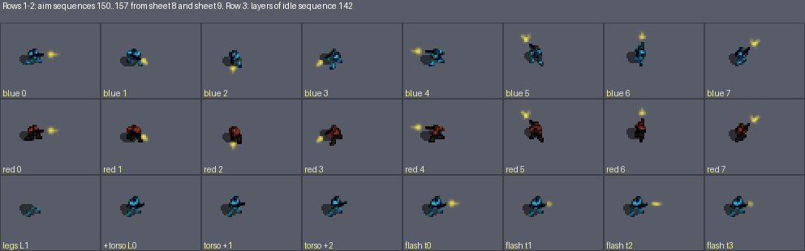

# Where do the pictures live?

> **In one line:** Every picture in the game is cut out of 43 PNG sheets packed in the file `i0`; 16 of them come with a second greyscale PNG that becomes the alpha channel.

## The short answer
- `i0` is a list of 86 slots (43 pairs). Even slot = colour PNG, odd slot = alpha mask PNG (often empty).
- All sprites go through **one** blit call. There is no flipping or rotation: every direction of every unit is drawn separately on the sheet.
- Blue and red infantry are the same cut-outs on two sheets (8 and 9). The code swaps sheet 8 for 9 when the unit belongs to side 1.
- Vehicles and buildings have their own art per faction (sheets 10/11 and 5 for the Confederation, 12/13 and 6 for the Rebels). Nothing is recoloured at run time.
- Smoke, fire, flashes, shadows and the HUD use real 8-bit alpha. Units, buildings and terrain use plain PNG transparency.

## How it works

**File format of `i0`.** Repeated until a byte `255` is read: a 3-byte big-endian length, then that many bytes of PNG. Length 0 means "no image in this slot". The loader keeps a counter `n`; slot `n` belongs to sheet `n >> 1`.

- Even slot: `Image.createImage(bytes)` becomes the sheet.
- Odd slot with data: the mask PNG is read as RGB, its **low byte (blue)** is taken as alpha for each pixel, and the sheet is rebuilt with `createRGBImage(..., true)`.

Sheets end up in `k.f324a[0][0..42]`. The sheet count 43 is the constant `k.f337j[0]`.

**The sheets.** "Pieces" is the number of rectangles the frame tables cut from the sheet (see [02](02-frame-tables.md)). A = has an alpha mask.

| Sheet | Size | A | Pieces | Holds |
|---|---|---|---|---|
| 0 | 240x320 | | 2 | title screen (globe, "Global Confederation") |
| 1 | 179x125 | | 199 | ground tiles, 30x20 px each, plus tile edge bits |
| 2 | 206x131 | | 87 | rocks |
| 3 | 229x114 | | 90 | trees |
| 4 | 200x63 | | 28 | bushes |
| 5 | 274x147 | | 89 | Confederation buildings, turret and dish frames, walls |
| 6 | 268x140 | | 56 | Rebel buildings and walls |
| 7 | 200x112 | | 45 | research icons |
| 8 | 77x152 | | 193 | infantry, blue |
| 9 | 77x152 | | 0 | infantry, red (same layout as 8, never referenced directly) |
| 10, 11 | 107x152, 153x49 | | 75, 36 | Confederation vehicles: hulls, turrets, deploy frames |
| 12, 13 | 91x109, 112x118 | | 43, 48 | Rebel vehicles |
| 14 | 223x78 | | 29 | building icons (build menu) |
| 15 | 154x71 | | 24 | unit icons (production panel) |
| 16 | 135x129 | A | 64 | black smoke puffs and scorch marks |
| 17 | 73x119 | A | 104 | bullet and shell tracers in 32 directions |
| 18 | 65x75 | A | 33 | light smoke, rocket trail puffs, gun smoke |
| 19 | 121x67 | A | 77 | shadows of units, buildings and decor |
| 20, 21 | 91x82, 94x63 | | 32, 12 | craters, wreck and ruin debris (ground decals) |
| 22 | 106x56 | | 47 | small stones and rubble (decor) |
| 23 | 169x30 | A | 20 | fire balls and explosion glow |
| 24 | 68x81 | A | 80 | muzzle flashes |
| 25 | 78x30 | | 20 | dirt puffs, jumping mine |
| 26 | 126x38 | A | 26 | yellow selection rings, order markers |
| 27 | 231x42 | A | 227 | HUD and dialog panels |
| 28 | 80x50 | A | 5 | panel gradient |
| 29 | 272x31 | A | 122 | HUD icons, brackets, buttons |
| 30 | 45x94 | | 46 | circuit-board trim of dialog frames |
| 31-34 | 110x83 each | A | 1, 4, 4, 4 | briefing satellite images |
| 35 | 133x36 | | 12 | four dialogue portraits |
| 36 | 61x43 | | 44 | blood |
| 37 | 88x53 | A | 7 | fog of war blob and dither patterns |
| 38 | 58x49 | A | 18 | briefing country outline and place names |
| 39 | 50x28 | | 24 | cursor arrows, health bar frames and fills |
| 40 | 63x16 | | 35 | rockets, small flying debris |
| 41 | 98x15 | | 3 | rank stripes |
| 42 | 33x7 | | 20 | sparks |

Piece ids 43..46 in the "sheet" field are not images. They mean line, rectangle outline, filled rectangle and large rectangle, drawn with `Graphics` calls ([02](02-frame-tables.md)).

**Team colour.** Proof that sheet 9 is sheet 8 recoloured: the same sequence drawn from both sheets.

Corrections to the first rough listing: sheet 7 is research icons (24 research items), the build-menu icons are sheets 14 (buildings) and 15 (units). `a.json seg[73..78]` are **not** sprite team colours: they are the cell colours of the full-screen map ([05](05-timing-and-draw-order.md)).

## How we know
- [`k.java:1001`](../evidence/decompiled/k.java#L1001) : opens `/i0`; loop runs `2 x 43` slots (Observed)
- [`k.java:1006`](../evidence/decompiled/k.java#L1006) : first byte 255 ends the list; [`k.java:1010`](../evidence/decompiled/k.java#L1010) : 3-byte length (Observed)
- [`k.java:1017`](../evidence/decompiled/k.java#L1017) : even slot becomes the sheet image (Observed)
- [`k.java:1024`](../evidence/decompiled/k.java#L1024) : mask pixel cast to `byte` = blue channel; [`k.java:1028`](../evidence/decompiled/k.java#L1028) : `alpha << 24 | rgb` (Observed)
- [`k.java:343`](../evidence/decompiled/k.java#L343) : sheet count 43 (Observed)
- [`g.java:7134`](../evidence/decompiled/g.java#L7134) : the only place a sheet is drawn; `sheet + 1` when sheet is 8 and flag `f176v` is set (Observed)
- [`g.java:7017`](../evidence/decompiled/g.java#L7017) : `f176v = unitIndex >= 51`, i.e. side 1 (Observed)
- [`g.java:6774`](../evidence/decompiled/g.java#L6774) : `drawRegion(..., transform 0, ..., anchor 20)`: no mirroring, top-left anchor (Observed)
- `../evidence/data/d0.json bytes[0]` : sheet number of each piece; counts per sheet in the table come from it; no piece names sheet 9 (Observed)
- `../evidence/tools/frames.py` : slicing every piece stays inside its sheet (0 of 2173 out of bounds) (Observed)
- Sheet contents: read from the extracted PNGs and from which frame ranges use each sheet (Observed for 0-27, 31-38; Inferred from small glyph-like art for 28-30, 39-42)

## Still unknown
- Why sheet 9 keeps PNG transparency while being stored as a separate full sheet (probably just an art pipeline choice).
- Files `wd`, `l2`, `gg`, `hc` are separate splash images outside `i0`; they were not decoded here.

**Next:** [How does a frame number become a picture on screen?](02-frame-tables.md)
