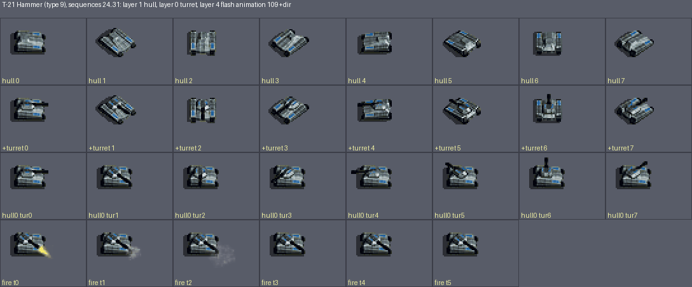

# How does a frame number become a picture on screen?

> **In one line:** The file `d0` is a six-level tree (piece, frame, animation, pose, sequence, object); each level is a "first index / last index" pair pointing into a list of children with pixel offsets.

## The short answer
- A **piece** is one rectangle on one sheet. There are 2173.
- A **frame** is a list of pieces (or other frames) with offsets. There are 2295. Most code draws frames.
- An **animation** is a list of frames, one per tick. There are 305.
- A **pose** is a unit picture built from layers (hull, turret, muzzle flash). There are 405. A **sequence** is a list of poses (263).
- An **object** is a building, wall, tree, rock or a whole HUD screen (146).
- No flip, no rotation, no scaling anywhere. Anchor is always top-left.

## How it works

`d0` holds 26 byte arrays then 18 short arrays, each prefixed by a 16-bit length. Below `B[n]` = `k.f327i[n]`, `S[n]` = `k.f328f[n]`. All ranges are inclusive.

| Level | Range tables | Child list | Draw helper |
|---|---|---|---|
| piece (2173) | none | `B0` sheet, `B1` x, `B2` y, `B3` w, `B4` h (unsigned), `B5` colour index | `g.d(id,x,y)` |
| frame (2295) | `S0` first, `S1` last | 7237 parts: `S2` child id, `S3` dx, `S4` dy, `B6` 0 = piece, 1 = frame | `g.a(id,x,y)` |
| animation (305) | `S5`, `S6` | 1704 steps: `S7` frame id, `B7` dx, `B8` dy, `B9` kind (always 1 = frame) | `g.n(id,x,y,tick,_)` |
| pose (405) | `S8`, `S9` | 992 parts: `S10` id, `B10` dx, `B11` dy, `B12` 0 piece / 1 frame / 2 animation, `B13` layer | inside `g.c(unit,x,y)` |
| sequence (263) | `S11`, `S12` | 797 steps: `S13` pose id, `B15` dx, `B16` dy | inside `g.c(unit,x,y)` |
| object (146) | `S14`, `S15` | 997 parts: `S16` id, `S17` dx, `B20` dy, `B23` kind 0/1/2, `B24` pass, `B25` condition | `g.a(id,x,y,pass,building)` |

Extra per-object fields: `B18`, `B19` = width and height in map cells.

**Piece.** Screen position = `(x + 15, y + 10)` plus a scroll offset. 15 and 10 are half a map cell (cells are 30x20 px). Sheet numbers 43..46 are drawing primitives using colour `n.a[B5]` (black, two blues, cyan, red): 43 line from (x,y) to (w,h), 44 rectangle outline, 45 filled rectangle, 46 outline with all four numbers times 4. Pieces 1397..1402 (bar fills) get their width replaced by the variable `g.y`, which is how health bars are clipped.

**Frame.** Each part is drawn at `(x + dx, y + dy)`. A part can be another frame, so frames nest. Many frames were authored around an origin of (90, 60), which is why the code so often calls `a(frame, px - 90, py - 60)`.

**Animation.** `step = first + tick % length`. The caller owns `tick`. One step lasts one game tick (100 ms). Slow animations repeat a frame in the list (animation 6, the Laboratory dish, is 30 steps with frame 1262 repeated 8 times).

**Pose layers (`B13`).** 1 = body or hull, 0 = turret or torso, 3 and 4 = muzzle-flash animations for weapon slots 0 and 1. Layers 2 and 5 (second turret) are supported by the code but no pose uses them. See [03](03-unit-animation.md).

**Object pass (`B24`).** 0 = base, painted once into the background buffer. 1 = top, drawn every frame in row order so units can stand behind it. 2 = special part handled by code (turret, flash, "switched off" frame, or a HUD slot). See [04](04-buildings-and-effects.md).

**Worked example: T-21 Hammer facing east, standing.** Unit type 9, state 0, direction 0 gives sequence 24. Sequence 24 has one step: pose 8 at offset (0,0). Pose 8 has three parts:

| Part | Kind | Layer | Offset | Meaning |
|---|---|---|---|---|
| frame 651 | 1 | 1 | (-29,-20) | hull: pieces 2126 and 2136 (shadow, sheet 19) and 364 (sheet 10, rect 51,55 25x18) at (33,20) |
| animation 109 | 2 | 4 | (-46,-35) | firing: step 0 = frame 667 = turret frame 659 + flash piece 805, shifted (-2,0) for recoil |
| frame 659 | 1 | 0 | (-46,-35) | turret: pieces 372 and 378 |

So the hull piece lands at `unitX - 29 + 33 + 15, unitY - 20 + 20 + 10`.

**Tool.** `../source/tools/frames.py SHEETS D0_JSON OUT` rebuilds all levels and writes the proof images in `img/`. `frames.py ... strip NAME KIND IDS` renders any piece, frame, anim, pose, seq or object.

## How we know
- [`k.java:1073`](../source/decompiled/k.java#L1073) : 26 byte arrays and 18 short arrays read from `/d0` (Observed)
- [`g.java:7104`](../source/decompiled/g.java#L7104) : piece sheet = `B0 & 255`; [`g.java:7110`](../source/decompiled/g.java#L7110) : `+15`, `+10`; [`g.java:7134`](../source/decompiled/g.java#L7134) : x, y, w, h from `B1..B4`, width override for pieces 1397..1402 (Observed)
- [`g.java:7117`](../source/decompiled/g.java#L7117) : cases 43..46 = drawLine, drawRect, fillRect, drawRect x4; [`n.java:5`](../source/decompiled/n.java#L5) : the 5 colours (Observed)
- [`g.java:7087`](../source/decompiled/g.java#L7087) : frame loop `S0..S1`, child `S2`, offsets `S3`/`S4`, `B6` picks piece or frame (Observed)
- [`g.java:7070`](../source/decompiled/g.java#L7070) : animation step = `S5 + tick % (S6 - S5 + 1)`; [`g.java:7076`](../source/decompiled/g.java#L7076) : offsets `B7`/`B8` (Observed)
- [`g.java:7012`](../source/decompiled/g.java#L7012) : sequence step from `S11`, pose `S13`, offsets `B15`/`B16`; [`g.java:7021`](../source/decompiled/g.java#L7021) : pose parts `S8..S9`, `S10`, `B10..B13` (Observed)
- [`g.java:6810`](../source/decompiled/g.java#L6810) : object parts `S14..S15`, `S16`, `S17`, `B20`, `B23..B25` (Observed)
- [`g.java:1116`](../source/decompiled/g.java#L1116) : `B18`/`B19` as footprint in cells (Observed)
- [`g.java:7007`](../source/decompiled/g.java#L7007) : example of the `- 90, - 60` origin convention (Observed)
- `../source/data/d0.json` : all counts; `bytes[9]` is 1 everywhere; layers present in `bytes[13]` are 0, 1, 3, 4 only (Observed)
- `../source/tools/frames.py` : composing with these rules gives clean sprites, none cut through (Observed, see images)

## Still unknown
- `B14` (263 values, all 4), `B17` (797 values, all 3), `B21` and `B22` (997 zeros each) are never read by the code. Probably editor leftovers.
- Animation ids 93..100 and 228 are single or empty placeholders; their purpose is unclear.

**Next:** [How does a soldier or tank animate?](03-unit-animation.md)
