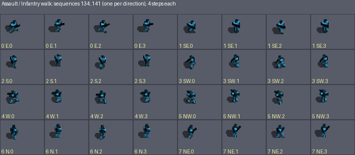
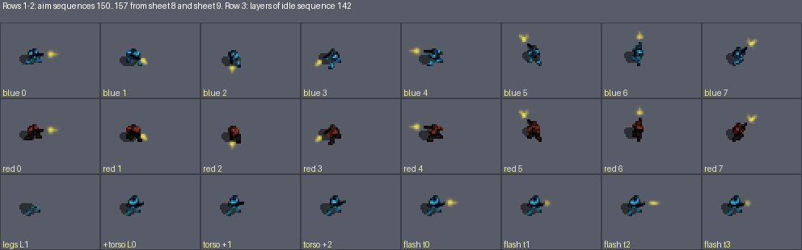
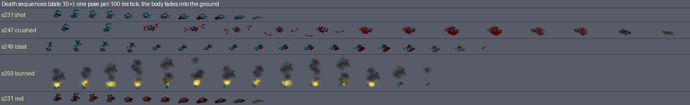

# How does a soldier or tank animate?

> **In one line:** A unit picks a sequence from `base[type][state] + direction`, steps one pose per 100 ms tick, and each pose is drawn in layers so the turret (or a soldier's torso) can face a different way from the hull (or legs).

## The short answer
- 8 facing directions, 45 degrees apart. 0 = east, then clockwise (1 south-east, 2 south, ... 6 north). No mirroring: all 8 are drawn.
- Infantry walk is 4 poses (A, B, C, B), so one walk cycle lasts 0.4 s. Standing is 1 pose. There is no idle fidgeting.
- Vehicles have **no** moving animation: driving and standing use the same single pose per direction.
- Turrets turn on their own: a second direction value shifts the turret frame id. Soldiers use the same trick for the torso.
- Firing swaps the turret/torso frame for a short flash animation (3 to 20 steps).
- Infantry die with one of 31 death sequences chosen by what killed them. Vehicles just vanish into an explosion and a crater.

## How it works

**Per-unit fields** (in the big array, index = offset + unit number):

| Offset | Meaning |
|---|---|
| 404 | hull / legs direction 0..7 |
| 505, 606 | direction of weapon slot 1, 2 (turret, torso) |
| 707, 808 | wanted direction for hull, turret |
| 202, 303 | pixel offset inside the cell while moving |
| 1313 | pose counter inside the current sequence |
| 1414 | state: 0 stand, 1 move, 2 vehicle dying, 3 transforming, 10+ infantry dying |
| 2525, 2626, 2727 | fire counter of weapon slot 0, 1, 2 |
| 2828 | bits 0..2 = weapon slot is firing |

**Choosing the sequence.**

```
if state >= 10:  seq = 231 + (state - 10)            # infantry death, no direction
else:            seq = base[type][state] + direction
                 (+8 for types 0..3 when standing and any fire bit is set = aim pose)
pose = sequence[seq][counter]      # counter restarts at 0 when past the end
```

`base` is a table in the code (`p.f502b`): stand, move, vehicle-death, transform.

| Type | Stand | Move | Transform | Notes |
|---|---|---|---|---|
| 0 Infantry, 1 Assault | 142 | 134 | | aim 150; same art, sheet 8 or 9 |
| 2 Grenadier, 3 Heavy Assault | 166 | 158 | | aim 174 |
| 4 Sniper | 206 | 198 | 214 | lies down, becomes type 14 |
| 5 Flame Assault | 190 | 182 | | |
| 6 Coyote | 75 | 67 | | |
| 7, 18 AV-40 Fortress | 8 | 0 | | |
| 8 Armadillo | 91 | 83 | | |
| 9 T-21 Hammer | 24 | 16 | | |
| 10 Rhino | 107 | 99 | 115 | 5-pose deploy, becomes type 15 |
| 11, 17 T-22 Zeus | 40 | 32 | | type 17 draws no turret (see below) |
| 12 Porcupine | 126 | 118 | | |
| 13 MLRS Torrent | 56 | 48 | 64 | 6-pose deploy, becomes type 16 |
| 14 / 15 / 16 deployed forms | 230 / 117 / 66 | | 222 / 116 / 65 | one pose, hull direction forced to 0 |

For vehicles the "stand" and "move" rows point at different sequence numbers that hold the same poses.



**Advancing.** Once per tick the counter goes up by one. At the end of the sequence it returns to 0. If the unit is dead it is removed at that moment. If the state was 3 (transform), the type is replaced by `seg[52][type]` and the state returns to 0.

**Turning.** Hull and each turret step one direction (45 degrees) toward the wanted direction every `seg[32][type*3 + part]` ticks. 0 or less means instant. Examples: T-21 hull every 4 ticks, turret every 2; Coyote hull 2, turret 1; MLRS hull 6; all infantry instant. A standing soldier's legs snap to the direction his weapon points. A vehicle that deploys first turns its hull to direction 0, then plays the transform sequence.

**Layers.** Each pose part has a layer number:

| Layer | Drawn as | Direction used |
|---|---|---|
| 1 | hull, or soldier legs + shadow | hull (already in the pose) |
| 0 | turret, or soldier torso + gun | id + (dir of slot 1 - hull dir) |
| 3 | flash animation of weapon slot 0 (hull gun) | hull |
| 4 | flash animation of weapon slot 1 | id + (dir of slot 1 - hull dir) |

A flash layer is only considered when that weapon's fire bit is set. It plays while the weapon's fire counter is within the animation length. While it plays it **replaces** the static part (layer 4 hides layer 0, layer 3 hides layer 1), because the flash frames already contain the turret with recoil. Fire counters run `0 .. reload-1` (`p.f521s[2][weapon]`), so the flash shows at the start of every reload cycle. Machine-gun type weapons (ids 0, 1, 4..9) restart the counter at `seg[46][weapon]` with 50% chance, which gives bursts of random length.

Type 17 (T-22 Zeus as built) skips every part that belongs to weapon slot 1, so it shows hull and hull gun only. Type 11 uses the same poses with the turret: the rocket launcher appears after the upgrade (Inferred from `seg[34]`: type 17 has weapon slot 0 only, type 11 has slots 0 and 1).



**Dying.** Infantry: state = 10 + (sequence - 231), sequence picked at random inside a group chosen by the damage kind. Each sequence is 8 to 27 poses and ends with the body fading into the ground, so no corpse object is needed.

| Killed by | Sequences |
|---|---|
| bullets (kind 0) | 231..246 |
| shells, rockets (kinds 1, 2) | 249..258 (thrown through the air) |
| flame (kind 3) | 259..261 (burning) |
| run over by a vehicle (kind 4) | 247..248 |



Vehicles: state 2 lasts one tick. At the moment of death the game spawns one explosion (animations 11..14), one flying-debris effect (27..31) and a crater decal ([04](04-buildings-and-effects.md)).

## How we know
- [`p.java:442`](../source/decompiled/p.java#L442) : the `base[type][state]` table (Observed)
- [`g.java:7009`](../source/decompiled/g.java#L7009) : sequence formula, `+8` aim rule (mask 15 = types 0..3), `231 + state - 10` (Observed)
- [`g.java:7012`](../source/decompiled/g.java#L7012) : pose = step `counter` or 0 if past the end (Observed)
- [`p.java:2049`](../source/decompiled/p.java#L2049) : counter +1 per tick; [`p.java:2058`](../source/decompiled/p.java#L2058) : type swap through `seg[52]`; [`p.java:2086`](../source/decompiled/p.java#L2086) : dead unit removed (Observed)
- [`p.java:1407`](../source/decompiled/p.java#L1407), [`p.java:1410`](../source/decompiled/p.java#L1410) : state 0 / 1 set by the movement code (Observed)
- [`p.java:2212`](../source/decompiled/p.java#L2212) : turn step through `seg[33]` every `seg[32]` ticks; [`p.java:2222`](../source/decompiled/p.java#L2222) : infantry legs follow weapon direction (Observed)
- [`p.java:1471`](../source/decompiled/p.java#L1471) : state 3 starts only when hull direction equals the wanted one; vehicles then get direction 0 (Observed)
- [`g.java:7019`](../source/decompiled/g.java#L7019) : layer mask from fire bits via `seg[54]`/`seg[55]`; [`g.java:7024`](../source/decompiled/g.java#L7024) : `seg[53][layer]` picks which direction field applies (Observed)
- [`g.java:7032`](../source/decompiled/g.java#L7032) : flash drawn while counter is within the animation; [`g.java:7033`](../source/decompiled/g.java#L7033) : it hides the static layer (Observed)
- [`g.java:7036`](../source/decompiled/g.java#L7036) : type 17 skips turret-slot parts (Observed)
- [`p.java:1381`](../source/decompiled/p.java#L1381) : fire counter modulo reload; [`p.java:1384`](../source/decompiled/p.java#L1384) : burst restart, mask 1011 (Observed)
- [`p.java:2552`](../source/decompiled/p.java#L2552) with [`p.java:424`](../source/decompiled/p.java#L424) and [`p.java:417`](../source/decompiled/p.java#L417) : death sequence = `{231,249,249,259,247}[kind] + random % {16,10,10,3,2}[kind]` (Observed)
- [`p.java:2190`](../source/decompiled/p.java#L2190) : damage kind 4 when a vehicle enters a soldier's cell (Observed)
- [`p.java:2555`](../source/decompiled/p.java#L2555) : vehicle death effects 11..14, 27..31 and decal kind 6 (Observed)
- `../source/data/a.json` `seg[1]` : direction 0 = (+1, 0), 2 = (0, +1): east, then clockwise with y pointing down (Observed)
- `../source/data/d0.json` : sequence lengths (walk 4, deploy 5 and 6, deaths 8..27) (Observed)

## Still unknown
- Sequence 262 (one burning pose) and state 2 for infantry (table value 231) look unused.
- Weapon slot 2 exists for types 7 and 12 (`seg[34]`) but no pose has layer 2 or 5 parts, so that weapon has no picture of its own.

**Next:** [How do buildings, shots and explosions animate?](04-buildings-and-effects.md)
