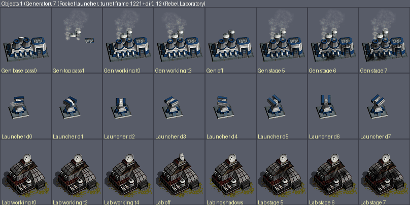
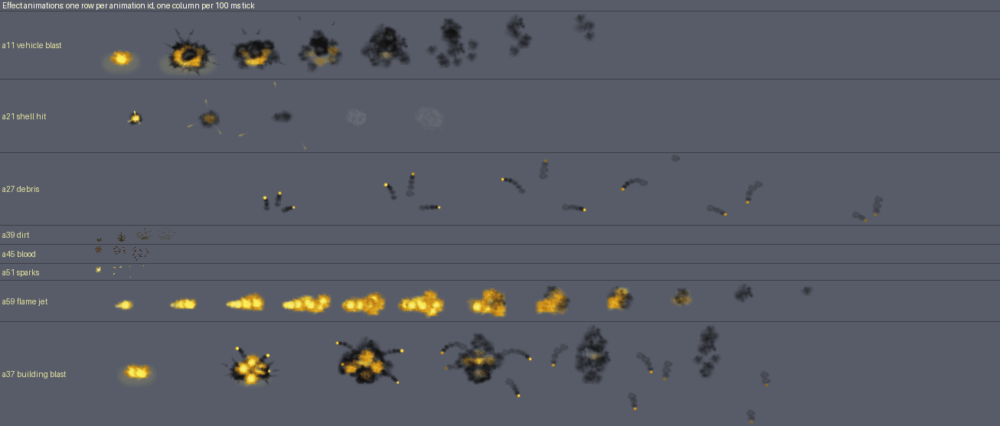
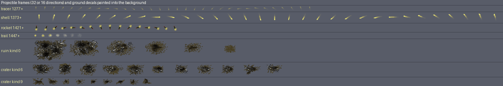

# How do buildings, shots and explosions animate?

> **In one line:** A building is an "object" drawn in two passes with parts switched on by damage, power and work state; shots live in a 400-slot ring, explosions in a 50-slot effect pool, and craters and ruins are painted straight into the background.

## The short answer
- Building type id = object id (0..14). There is no construction artwork: an unfinished building is the finished picture with its animations off and an orange bar.
- Damage has 4 looks: intact, below 75%, below 50%, below 25% of max HP. Each adds scorch marks and holes.
- Smoke stacks and radar dishes move only when the building has power and, for factories and laboratories, only while something is being produced.
- Every effect animation advances one step per 100 ms tick and is then freed. Longest explosion: 9 steps (0.9 s).
- Ruins and craters fade in stages of about 48 seconds each.
- Bullets and shells have 32 direction frames, rockets 16 plus a smoke trail, the flamethrower is one 12-step animation sheared along the firing direction.

## How it works

### Buildings

**Two passes.** Parts with pass 0 (the base) are painted into the background buffer. Parts with pass 1 (roofs, masts, smoke, shadows of Rebel buildings) are drawn every frame in row order, so a unit standing behind a building is covered by it.

**Damage stage.** `stage = clamp(7 - 4*hp/maxHp, 4, 7)`, forced to 4 while under construction and 7 when HP is the "destroyed" marker. A part with condition 5, 6 or 7 is drawn in the base pass when it **equals** the stage, in the top pass when it is **less than or equal** (so top-pass damage piles up).

**Working animation.** Animation parts play with `tick = gameTick + type + buildingIndex` (so two generators are out of phase) when all of these hold: power flag (offset 7171) set, not under construction, and either the building is not a producer or it is producing now. Producers are types 2, 3, 10, 11 (`seg[94] % 3 > 0`) and the laboratories 4 and 12. Examples: animation 0 (8 steps) turns the Command centre and Locator dishes, 7..10 are the same 8 smoke frames at four phases, 6 is the Rebel Laboratory dish (30 steps).

**Switched-off frame.** A condition-10 part (objects 0, 6, 8, 12) is a still frame shown in the opposite case. Without power a lightning icon blinks on the building (animation 269: 4 ticks on, 4 off).

**Construction.** HP rises by 1 every 3 ticks until it reaches `seg[59][type]`; the bar uses the orange fill piece 1401. A 120 HP Generator therefore needs at most 360 ticks (36 s).

**Guns.** `seg[60][type]` gives a weapon to types 5, 7, 8, 10, 12, 13, 14. A condition-1 part is a flash animation `id + direction` (offset 7070, 8 directions) shown while the fire counter (offset 6969) is below `seg[46][weapon]`. A condition-2 part is a turret frame `id + direction`; only the Rocket launcher has one (frames 1221..1228).

**Destruction.** HP is set to -1 and an explosion from animations 32..38 is spawned. Two ticks later the record is cleared, the whole background is redrawn and a ruin decal `seg[64][type]` (kinds 0..5) is placed at the centre.

**Walls.** A wall cell stores `1001 + side*100 + damage`. Object = `{15, 25}[side] + damage / 20`, so 5 damage looks per side.

### Projectiles (400-slot ring)

`seg[48][type]` is the draw kind, `seg[49][type]` the art set.

| Kind | Picture | Directions |
|---|---|---|
| 0 bullet | frame `1277 + set*32 + dir` | 32 |
| 1 shell | frame `1341 + set*32 + dir` | 32 |
| 2 rocket | frame `1405 + set*16 + dir`, plus up to 7 trail puffs `1440 + set*7 + i` placed along the last 4 steps | 16 |
| 3 flame | animation 59, x stretched and y sheared with the sine table `seg[14]` | 32 |

Life in steps = `seg[5][21*|dy| + |dx|] / seg[38][type]` (distance table over speed), one step per tick. Direction comes from comparing the slope with `tables[0]` (16 thresholds) or `tables[1]` (8). A flame lives about 13 ticks (the length of animation 59 plus one) and moves only during the first 6.

### Effects (50-slot pool)

When a projectile ends, `group = M[type*3 + outcome]` (outcome 0 = vehicle, building or ground, 1 = the aimed-at unit moved away, 2 = infantry hit) and a random animation of that group starts at the impact point with 1 px jitter. It is only created if the cell is on screen.

| Group | Animations | Looks like |
|---|---|---|
| 0, 1, 2 | 11..14, 15..17, 18..20 | large, medium, small explosion with smoke |
| 3 | 21..24 | shell hit with sparks |
| 4 | 25..26 | jumping mine |
| 5 | 27..31 | burning debris arcs (vehicle death) |
| 6, 7, 8 | 32..34, 35..36, 37..38 | building explosions (picked by `N[type]`) |
| 9, 10 | 39..41, 42..44 | dirt puffs |
| 11, 12 | 45..47, 48..50 | blood |
| 13, 14 | 51..54, 55..58 | sparks on armour |

### Ground decals (89 slots)

Decals are frames `first[kind] + variant` with `first = 1741, 1747, 1753, 1759, 1764, 1769, 1773, 1784, 1793, 1802` (end 1811). Kinds 0..5 are ruins: the variant steps forward (smaller each time) and the decal is removed after the last. Kinds 6..9 are craters: the kind steps up with a new random variant and the decal is removed after kind 9. Each decal is touched once every 16 ticks and needs 30 touches per stage: 480 ticks = 48 s. The last touch waits until the decal is off screen, because the picture is baked into the background buffer. A new blast on an old crater makes it one kind fresher.

## How we know
- [`g.java:4071`](../evidence/decompiled/g.java#L4071) : pass 0 while rebuilding the background; [`g.java:4141`](../evidence/decompiled/g.java#L4141) : pass 1 in the per-frame loop (Observed)
- [`g.java:6809`](../evidence/decompiled/g.java#L6809) : stage formula; [`g.java:6970`](../evidence/decompiled/g.java#L6970) : equal / less-or-equal rule (Observed)
- [`g.java:6975`](../evidence/decompiled/g.java#L6975) : conditions for animation parts and their tick (Observed)
- [`g.java:6954`](../evidence/decompiled/g.java#L6954), [`g.java:6959`](../evidence/decompiled/g.java#L6959), [`g.java:6964`](../evidence/decompiled/g.java#L6964) : condition 1 flash, 2 turret, 10 switched-off (Observed)
- [`g.java:4393`](../evidence/decompiled/g.java#L4393) : animation 269 when the power flag is 0 (Observed)
- [`p.java:1852`](../evidence/decompiled/p.java#L1852) : construction HP +1 every 3 ticks; [`g.java:4369`](../evidence/decompiled/g.java#L4369) : bar piece 1401 (Observed)
- [`p.java:2574`](../evidence/decompiled/p.java#L2574) : HP = -1 and explosion group `N[type]`; [`p.java:1742`](../evidence/decompiled/p.java#L1742) : ruin decal; [`p.java:1682`](../evidence/decompiled/p.java#L1682) : full redraw (Observed)
- [`g.java:4297`](../evidence/decompiled/g.java#L4297) with [`g.java:871`](../evidence/decompiled/g.java#L871) : wall object formula (Observed)
- [`g.java:4510`](../evidence/decompiled/g.java#L4510) : the four projectile draw kinds; [`g.java:7107`](../evidence/decompiled/g.java#L7107) : flame shear through `seg[14]` (Observed)
- [`p.java:2273`](../evidence/decompiled/p.java#L2273) : life = distance / speed; [`p.java:2285`](../evidence/decompiled/p.java#L2285) : direction from slope thresholds; [`p.java:2304`](../evidence/decompiled/p.java#L2304), [`p.java:2348`](../evidence/decompiled/p.java#L2348) : flame life and 6 moving steps (Observed)
- [`p.java:2435`](../evidence/decompiled/p.java#L2435) with [`p.java:418`](../evidence/decompiled/p.java#L418), [`p.java:419`](../evidence/decompiled/p.java#L419) : effect group and random pick (Observed)
- [`p.java:2702`](../evidence/decompiled/p.java#L2702) : effect only if on screen; [`p.java:1795`](../evidence/decompiled/p.java#L1795) : +1 per tick, freed past the last step; [`g.java:4152`](../evidence/decompiled/g.java#L4152) : drawn per cell (Observed)
- [`p.java:445`](../evidence/decompiled/p.java#L445) : decal frame table; [`p.java:2640`](../evidence/decompiled/p.java#L2640) : painted into buffer 0; [`p.java:2733`](../evidence/decompiled/p.java#L2733) : 16-tick cadence, 30 touches, off-screen rule; [`p.java:2688`](../evidence/decompiled/p.java#L2688) : crater refreshed (Observed)
- `../evidence/data/a.json` `seg[59]` (max HP), `seg[60]`, `seg[64]`, `seg[94]`, `seg[48]`, `seg[49]` (Observed)
- Group descriptions: from rendering each animation with `../evidence/tools/frames.py` (Observed)

## Still unknown
- A base-pass damage part can only appear when the background is repainted (scroll or full redraw); no explicit redraw on stage change was found (Inferred).
- Objects 20..24 look like a second wall style but are not reached by the `{15, 25}` formula.
- Nothing on construction time here: a new building starts at 10% of full HP and gains 1 HP every 3 ticks, see [gameplay/03-building-and-training](../gameplay/03-building-and-training.md).

**Next:** [How fast does it run, and what is drawn on top of what?](05-timing-and-draw-order.md)
