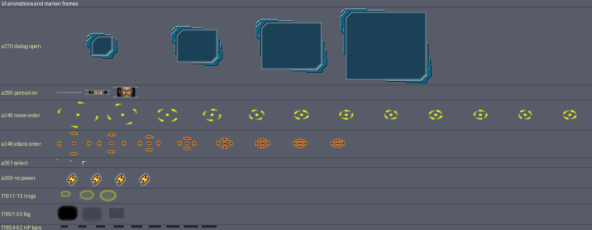

# How fast does it run, and what is drawn on top of what?

> **In one line:** The game runs 10 logic ticks per second, every animation step lasts exactly one tick, and each picture is built as "cached background, then cells row by row, then fog, cursor, HUD, dialog".

## The short answer
- One tick = 100 ms. Units, effects, building animations and UI animations all advance one step per tick.
- Graphics MAX draws a second, in-between picture every tick (20 pictures per second). MIN and MED draw 10.
- The loop never skips work: on a slow phone the whole game slows down.
- Ground, craters and building bases are painted once into an off-screen image and reused. Scrolling shifts that image and repaints only the new strip.
- Units and building tops are drawn cell by cell, top row first, so lower rows cover higher ones.
- Graphics MIN removes shadows, soft fog edges, dialog animations and live minimap updates. MED keeps those. MAX adds smooth half-cell scrolling and half-step projectiles.

## How it works

**The loop** (`k.run`). Each pass: read input, run the simulation once (`p.b()`, which ends with `tick++`), draw (`g.a(true)`), request a repaint, then sleep `100 - elapsed` ms. `Thread.sleep` is never called with less than 3 ms. The on-screen mission clock is computed as `tick * 100` ms.

With MAX graphics, in battle, the pass becomes: sleep to 50 ms, move projectiles one more half step, draw again, sleep to 100 ms. Projectile step sizes are halved in this mode so their speed is the same.

**Buffers.** The view is 8 cells wide (cells are 30x20 px, so 240 px) and `(H-1)/20 + 1` cells tall.

| Image | Size | Use |
|---|---|---|
| `k.f282a[0]` | 270 x (H+20) | background: ground tiles, decals, base pass of buildings and decor |
| `k.f282a[1]` | 270 x (H+20) | the finished picture; shown on screen at (-15, -10) |
| `k.f282a[2]` | 51 x 51 | cached minimap (used at MIN only) |

The extra 15 and 10 px on each side are half a cell. They let sprites hang over the edge and let MAX show the picture shifted by half a cell for one in-between picture while scrolling. HUD parts are drawn with the opposite shift so they stay still.

**Scrolling.** A one-cell scroll copies the background shifted by 30 or 20 px, repaints the ground tiles and decals of the new column or row, then repaints object bases. Mode 4 repaints everything (new mission, building removed, wall destroyed, menu closed).

**Draw order of one picture** (`g.a(boolean)`):

1. Background buffer copied in.
2. For each row top to bottom, each column left to right, in this order per cell:
   - the unit standing in the cell (ring, layers, health bar; skipped if the cell is fogged), or else the top pass of the building / tree anchored there;
   - effect animations linked to the cell;
   - projectiles currently in the cell;
   - rally-point marker; fog shade for "seen before, not visible now" cells.
3. Build-range outline while placing a building: 20 line segments from the ellipse table `tables[8]`.
4. Unexplored cells: black rectangles, merged along each row, then a soft blob (frame 1851) on unexplored cells that touch explored ones.
5. Cursor layer: order marker animation, placement ghost (green tile 2044 / red tile 2045 plus cost text), cursor animation, drag box.
6. HUD objects: 133 (top bar), 134 (group buttons), 145 (bottom panel), 144 (soft keys).
7. Dialog: opening animation or the dialog object 135..143 centred at (120, H/2).

Only one unit can own a cell, so "sort by row" needs no sorting: the occupancy grid is walked in order.

**Graphics option** (`T0_22` MIN = 0, `T0_23` MED = 1, `T0_24` MAX = 2; default 2):

| Feature | MIN | MED | MAX |
|---|---|---|---|
| in-between picture, half-cell scroll, half-step projectiles | | | yes |
| sliding scroll in menu lists | | | yes |
| dialog open / close animation (270 / 271) | | yes | yes |
| shadows (pieces >= 2095, frames >= 2257) | | yes | yes |
| minimap | cached, redrawn every 10 ticks | live | live |
| fog of war | coarse dither 1853, no soft edge | dither 1852 + soft edge | same as MED |
| drag-box fill tiles, full HUD art | simplified | yes | yes |

**Health bars.** Unit: frame `1854 + (maxHp - 30) / 12` (9 widths), fill width `(12 + 2*((maxHp-30)/12)) * hp / maxHp`, fill piece `1399 - (hp-1)*3/maxHp`: 1397 green, 1398 yellow, 1399 red. Building: frame `1863 + (maxHp - 100) / 35` (5 widths), orange piece 1401 while under construction, and a second blue bar (piece 1400) for production progress. Selection rings are frames 1811..1813 (small to large, chosen by `seg[57][type]`).

**UI animation.**

| What | Animation | Steps |
|---|---|---|
| dialog window grows / shrinks | 270 / 271 | 4 |
| briefing: country outline with zoom bracket | 294 | 13 |
| briefing: satellite zoom | 295..297 | 36..42 |
| briefing: pulsing red target ring, one per mission | 298..304 | 4, looped |
| portrait switches on / off like a TV | 290..293 / 286..289 | 3 |
| move order / attack order marker | 246 / 248 | 12 / 8 |
| selection brackets snap in, then stay | 257..268 | 3 |
| minimap alarm ring | 285 | 14 |
| "no power" lightning | 269 | 4 on, 4 off |

Splash: up to four logo files (`prov.png`, `prov2.png`, `gg`, `hc`). For each, the background colour fades to the logo's colour in 15 steps of 16 ms, then the logo stays 1600 ms. Then the `l2` picture with a progress bar up to 98 px wide near the bottom, moved at fixed loading checkpoints. The menu background is frame 2134 (sheet 0). When a menu opens over a battle, the last battle picture is dimmed with the dither frame 2133.

## How we know
- [`k.java:771`](../source/decompiled/k.java#L771) : simulation then draw; [`k.java:792`](../source/decompiled/k.java#L792) : `sleep(100 - elapsed)`; [`k.java:783`](../source/decompiled/k.java#L783) : the MAX branch with two 50 ms halves (Observed)
- [`a.java:581`](../source/decompiled/a.java#L581) : sleep is at least 3 ms (Observed)
- [`p.java:1821`](../source/decompiled/p.java#L1821) : tick counter +1 per simulation step; [`g.java:5591`](../source/decompiled/g.java#L5591) : clock = tick x 100 ms (Observed)
- [`p.java:2273`](../source/decompiled/p.java#L2273) : projectile life doubled when the MAX flag is set (Observed)
- [`k.java:665`](../source/decompiled/k.java#L665), [`k.java:682`](../source/decompiled/k.java#L682), [`k.java:684`](../source/decompiled/k.java#L684) : the three images; [`k.java:861`](../source/decompiled/k.java#L861) : shown at (-15, -10) plus scroll offset; [`k.java:651`](../source/decompiled/k.java#L651) : rows (Observed)
- [`g.java:4034`](../source/decompiled/g.java#L4034) : shifted copy; [`g.java:4046`](../source/decompiled/g.java#L4046) : tiles; [`g.java:4059`](../source/decompiled/g.java#L4059) : decals; [`g.java:4071`](../source/decompiled/g.java#L4071) : bases (Observed)
- [`g.java:7112`](../source/decompiled/g.java#L7112) : HUD compensation of the half-cell shift (Observed)
- [`g.java:4084`](../source/decompiled/g.java#L4084), [`g.java:4089`](../source/decompiled/g.java#L4089), [`g.java:4090`](../source/decompiled/g.java#L4090), [`g.java:4098`](../source/decompiled/g.java#L4098), [`g.java:4109`](../source/decompiled/g.java#L4109) : steps 1, 2-4, 5, 6, 7 (Observed)
- [`g.java:4143`](../source/decompiled/g.java#L4143), [`g.java:4152`](../source/decompiled/g.java#L4152), [`g.java:4158`](../source/decompiled/g.java#L4158), [`g.java:4164`](../source/decompiled/g.java#L4164) : per-cell order; [`g.java:4176`](../source/decompiled/g.java#L4176) : ellipse; [`g.java:4215`](../source/decompiled/g.java#L4215), [`g.java:4232`](../source/decompiled/g.java#L4232) : black fill and edge (Observed)
- [`g.java:6738`](../source/decompiled/g.java#L6738) : one unit index per cell in the occupancy grid (Observed)
- [`g.java:3965`](../source/decompiled/g.java#L3965) : the eight flags set from the level; [`k.java:638`](../source/decompiled/k.java#L638) : default 2 (Observed)
- [`g.java:7086`](../source/decompiled/g.java#L7086), [`g.java:7103`](../source/decompiled/g.java#L7103) : shadow cut-offs; [`g.java:4655`](../source/decompiled/g.java#L4655) : minimap cache every 10 ticks; [`g.java:1204`](../source/decompiled/g.java#L1204) : dialog animation only with flag; [`g.java:2841`](../source/decompiled/g.java#L2841) : list slide (Observed)
- [`g.java:7053`](../source/decompiled/g.java#L7053), [`g.java:4368`](../source/decompiled/g.java#L4368), [`g.java:4386`](../source/decompiled/g.java#L4386) : bar formulas; bar colours read from sheet 39 (Observed)
- [`g.java:1199`](../source/decompiled/g.java#L1199) : UI counters +1 per tick; [`g.java:2775`](../source/decompiled/g.java#L2775) : briefing phases; [`g.java:1852`](../source/decompiled/g.java#L1852) : portrait animations 290 / 286; [`g.java:3402`](../source/decompiled/g.java#L3402) : markers 246 / 248; [`g.java:1842`](../source/decompiled/g.java#L1842) : selection brackets (Observed)
- [`k.java:420`](../source/decompiled/k.java#L420), [`k.java:446`](../source/decompiled/k.java#L446), [`k.java:459`](../source/decompiled/k.java#L459) : splash files, 16 ms fade, 1600 ms hold; [`k.java:482`](../source/decompiled/k.java#L482) : progress bar; [`g.java:6016`](../source/decompiled/g.java#L6016), [`g.java:4101`](../source/decompiled/g.java#L4101) : frames 2134 and 2133 (Observed)
- `../source/data/a.json` `seg[73..78]` with [`g.java:5964`](../source/decompiled/g.java#L5964) : colours of the full-screen map cells (bright set and dimmed set), not sprite colours (Observed)

## Still unknown
- [`k.java:794`](../source/decompiled/k.java#L794) calls `g.m44b()` when a battle pass took over 3 s; what that does was not traced (probably opens the pause menu).
- The "simplified HUD" at MIN is a frame id + 1 variant; it was not rendered.
- `seg[133]`, `seg[134]`, `seg[137]`, `seg[138]` are not referenced with literal indexes in `g.java` or `p.java`; likely font or text tables.

**Next:** [Back to the index](README.md)
