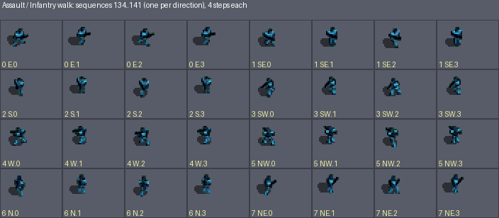
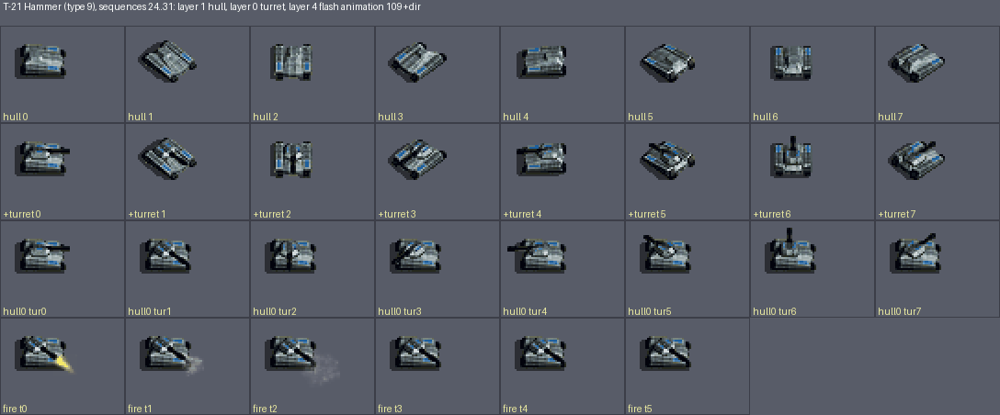
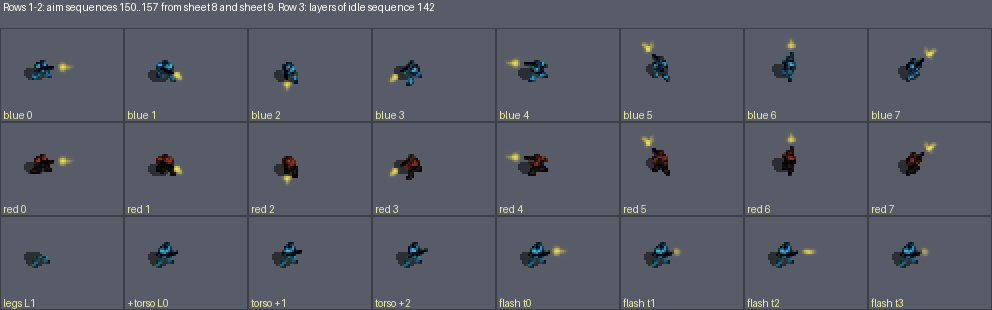
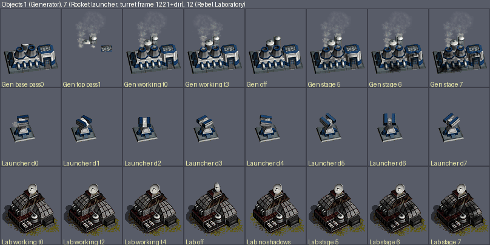
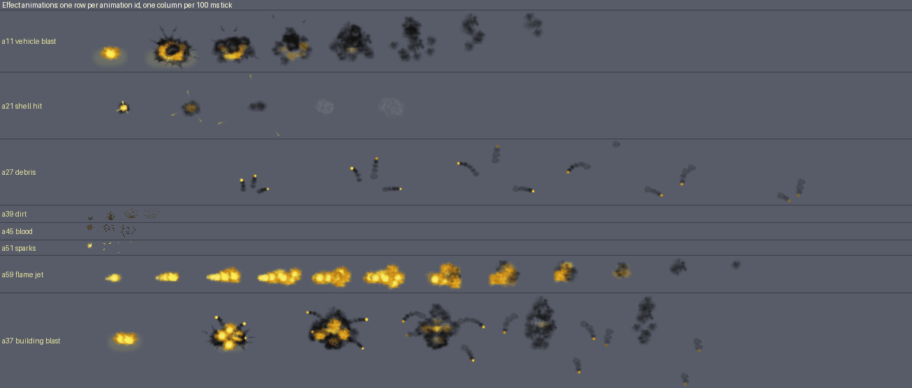
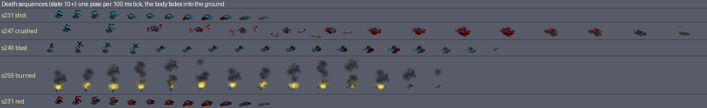
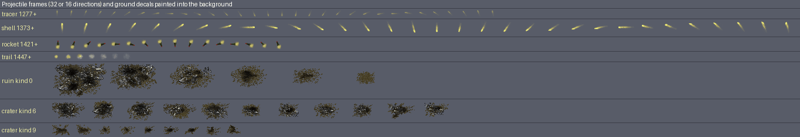
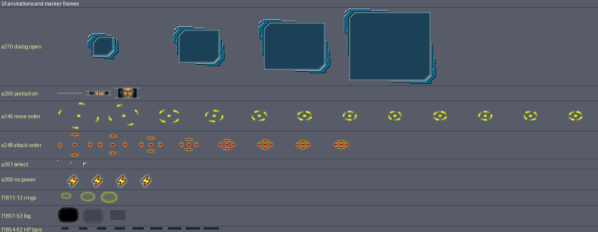

# Animations: how the pictures are stored, cut and moved

Five notes that follow a picture from the packed file to the screen. For
the short "how would I build this" version, read
[build/08-animation-recipe](../build/08-animation-recipe.md).

## The idea in one minute

All art sits on 43 sprite sheets. A data file (`d0`) describes a six-level
tree: **piece** (a rectangle on a sheet) -> **frame** (pieces with offsets)
-> **animation** (frames over time) -> **pose** (a unit in layers) ->
**sequence** (poses over time) -> **object** (a building or panel). A unit
picks a sequence from its type, state and facing, and advances one pose per
100 ms tick. Turrets and torsos are separate layers with their own facing.
Nothing is flipped, rotated or scaled.

## The notes

| # | Note | In one line |
|---|---|---|
| 1 | [Sprite sheets](01-sprite-sheets.md) | 43 PNG sheets in `i0`; 16 have a separate mask that becomes alpha |
| 2 | [Frame tables](02-frame-tables.md) | The six levels of `d0`, field by field, with a worked example |
| 3 | [Unit animation](03-unit-animation.md) | 8 directions, 4-pose walk, layered turret and flash, 31 infantry deaths |
| 4 | [Buildings and effects](04-buildings-and-effects.md) | Two-pass buildings, damage stages, projectile and effect pools, decals |
| 5 | [Timing and draw order](05-timing-and-draw-order.md) | 10 ticks per second, cached background, row-by-row drawing, quality levels |

## Proof images

Each was produced by [`frames.py`](../source/tools/frames.py) from the
decoded tables. If the decoding were wrong, sprites would be cut through.

| Image | Shows |
|---|---|
|  | Infantry walk: 8 directions x 4 steps |
|  | Tank hull, turret layer, independent turret, firing flash |
|  | Blue and red infantry from the same frame data |
|  | Building base and top passes, working, off, damaged |
|  | Explosion effect sequences |
|  | Infantry death sequences |
|  | Projectiles by direction, ruins and craters |
|  | Dialog, markers, fog patterns, health bars |

## Draw it yourself

```bash
python3 -I source/tools/frames.py <sheets-dir> source/data/d0.json <out-dir>
```

`<sheets-dir>` is the output of `sprites_extract.py` followed by
`sprites_contact_sheet.py` (which writes the merged colour+alpha PNGs). See
[source/README](../source/README.md).
