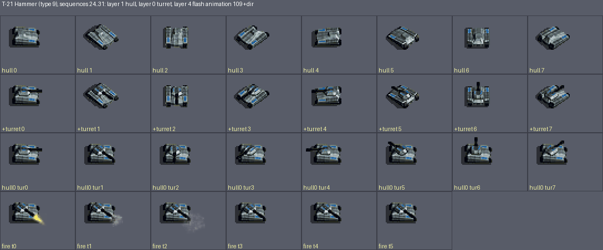

# How do you animate an army with almost no memory?

> **In one line:** Cut small rectangles from shared sheets, describe every
> picture as a list of rectangles with offsets, and let one counter per unit
> walk through lists of those pictures.

## The idea

A tank that can face 8 ways, with a turret that faces 8 ways on its own,
would need 64 drawings if each combination were one picture. Add a firing
flash and it is 128. The original ships 43 small sheets for everything in
the game. How does it avoid drawing the combinations?

It never stores a combination. It stores **parts** and a recipe for
stacking them, and it builds the picture at draw time.

## What the original does

A six-level tree, all numbers in one data file (`d0`):

| Level | What it is | Count |
|---|---|---|
| Piece | One rectangle on one sheet | 2173 |
| Frame | Pieces (or frames) with x,y offsets | 2295 |
| Animation | A list of frames, one per tick | 305 |
| Pose | A unit picture in layers: hull, turret, flash | 405 |
| Sequence | A list of poses (walk cycle, death) | 263 |
| Object | A building, tree or whole HUD panel | 146 |

Each level is the same trick: two numbers, "first child" and "last child",
pointing into a long list.

**Choosing what to draw for a unit**

```
sequence = base[type][state] + direction        # 8 directions, 0 = east
pose     = sequence[counter]                    # counter +1 per tick
for layer in pose:                              # hull first, turret on top
    draw(frame_of(layer) + turret_direction if layer is turret)
```

- Infantry walk = 4 poses, so a step cycle is 0.4 s.
- Vehicles have one pose per direction; they do not animate while driving.
- A turret is the same frame id shifted by its own direction.
- Firing swaps the turret frame for a short flash animation with recoil.



**Other tricks**

| Trick | Saving |
|---|---|
| No flipping or rotating; every direction is drawn | Simple, fast blit; costs sheet space |
| Blue and red infantry are the same layout on two sheets | One set of frame data, swap the sheet by side |
| Soft effects use a separate mask image as alpha | Smooth smoke on phones that lacked alpha PNGs |
| One tick = one animation step | No per-animation timers; slow motion = repeat a frame in the list |
| Buildings split into "base" (painted once) and "top" (drawn each frame) | Units can walk behind roofs cheaply |

## Recipe

1. Pack art into atlases; address art by rectangle id, never by file.
2. Define a frame as rectangles + offsets, so a shadow or a turret is
   reused across many frames.
3. Define animations as lists of frame ids advanced by the game tick.
4. Index sequences as `base[type][state] + direction`.
5. Draw units in layers so independent parts (turret, torso, flash) do not
   multiply the art.
6. Write a viewer tool first. The proof images in
   [animations/img](../animations/img/) came from such a tool.

## Knobs

| Knob | Original | Note |
|---|---|---|
| Directions | 8 | 16 looks smoother and doubles the art |
| Walk poses | 4 | The cheapest readable walk |
| Step length | 1 tick (100 ms) | Tie it to the rule tick or interpolate |

## Pitfalls seen in the original

- **Vehicles slide.** With no track or wheel animation, movement reads only
  from position. Two alternating hull frames would fix it.
- **Animation speed is the rule tick.** A slow device slows the animation
  and the rules together. Interpolate drawing between rule steps.
- **Magic origins.** Many frames assume an origin of (90, 60) that only the
  code knows. Store the anchor in the data.
- **No tooling shipped with the data.** The tables are unreadable without a
  viewer. Keep the authoring format next to the packed one.

## Evidence
- The tree, field by field: [animations/02-frame-tables](../animations/02-frame-tables.md)
- Unit sequences, directions and layers: [animations/03-unit-animation](../animations/03-unit-animation.md)
- Sheets and the alpha-mask trick: [animations/01-sprite-sheets](../animations/01-sprite-sheets.md)
- Buildings, shots and explosions: [animations/04-buildings-and-effects](../animations/04-buildings-and-effects.md)
- Speed and draw order: [animations/05-timing-and-draw-order](../animations/05-timing-and-draw-order.md)
- `../evidence/tools/frames.py` : rebuilds every level from `d0` and rendered
  the image above; hulls, turrets and flashes line up, which confirms the
  decoding (Observed)

**Next:** [A balance study](09-balance-study.md)
